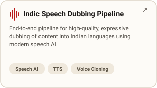
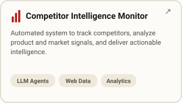
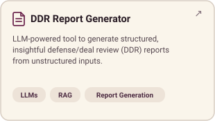

<!-- ========================================== -->
<!-- 1. HERO BANNER                            -->
<!-- ========================================== -->

  

<!-- ========================================== -->
<!-- 2. ABOUT SECTION WITH ANIMATED TYPEWRITER -->
<!-- ========================================== -->

  

 

<!-- ========================================== -->
<!-- 3. QUICK LINKS / SOCIALS                   -->
<!-- ========================================== -->

  
  &nbsp;
  
  &nbsp;
  
  &nbsp;
  

 

<!-- ========================================== -->
<!-- 4. FEATURED PROJECTS                      -->
<!-- ========================================== -->
### ▍ Featured Projects

  
  &nbsp;
  
  &nbsp;
  

 

<!-- ========================================== -->
<!-- 5. SKILLS & TECH STACK                    -->
<!-- ========================================== -->
### ▍ Skills & Stack

  
  &nbsp;
  
  &nbsp;
  
  &nbsp;
  
  &nbsp;
  
  &nbsp;
  
  &nbsp;
  
  &nbsp;
  
  &nbsp;
  

 

<!-- ========================================== -->
<!-- 6. FOOTER                                  -->
<!-- ========================================== -->

  

