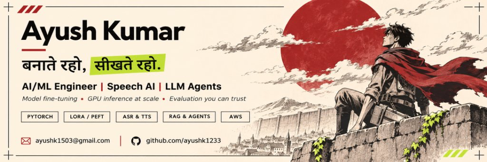
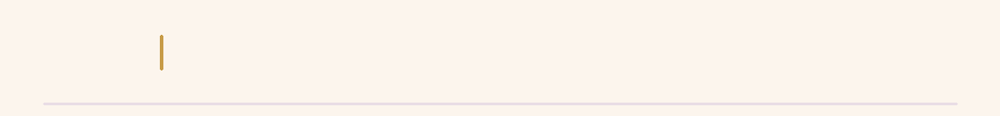
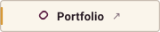
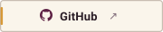

<!-- ========================================== -->
<!-- 1. HERO BANNER                            -->
<!-- ========================================== -->

  

<!-- ========================================== -->
<!-- 2. ANIMATED TYPEWRITER BANNER             -->
<!-- ========================================== -->

  

 

<!-- ========================================== -->
<!-- 3. LINKS & SOCIALS                        -->
<!-- ========================================== -->

  
  &nbsp;
  
  &nbsp;
  
  &nbsp;
  

